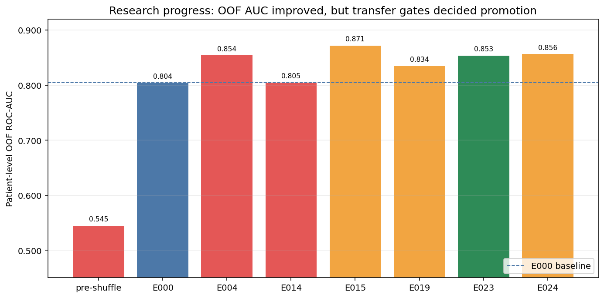
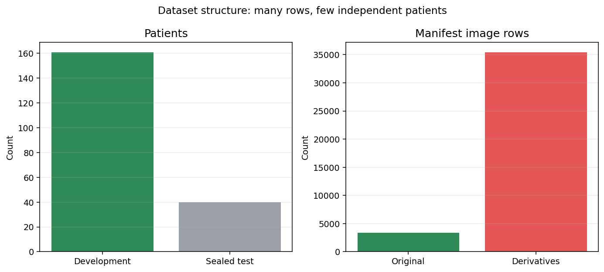
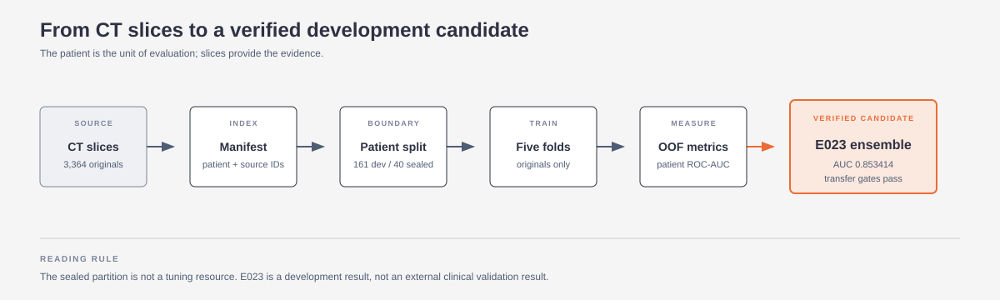
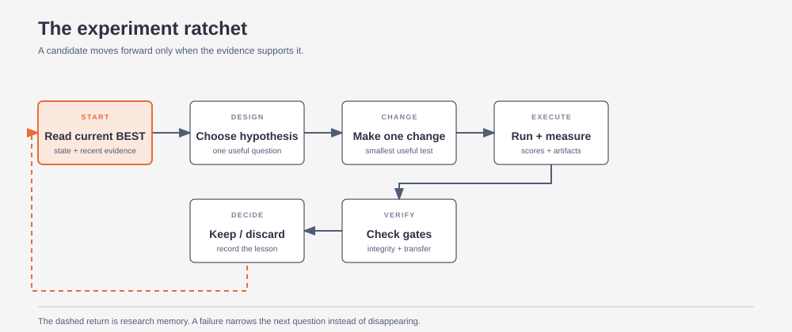
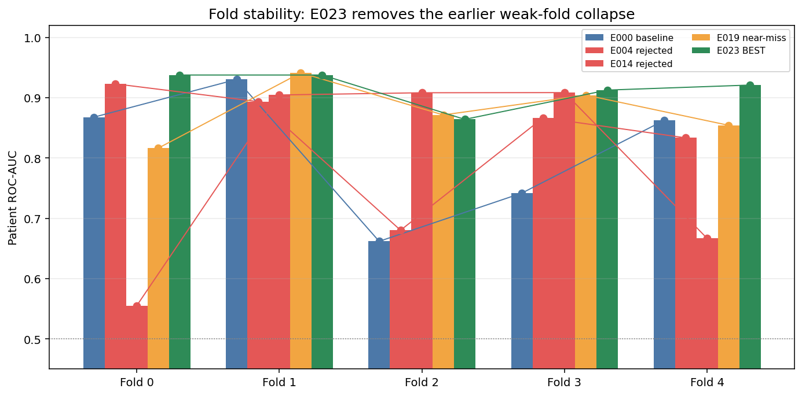
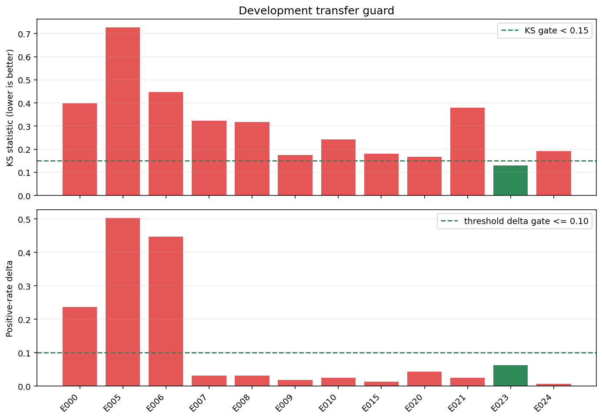
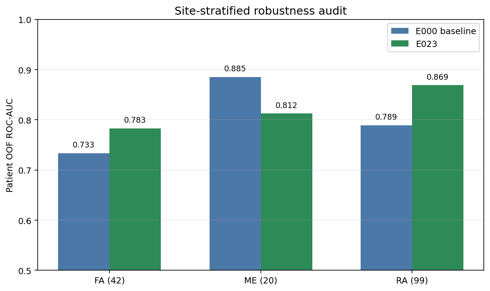
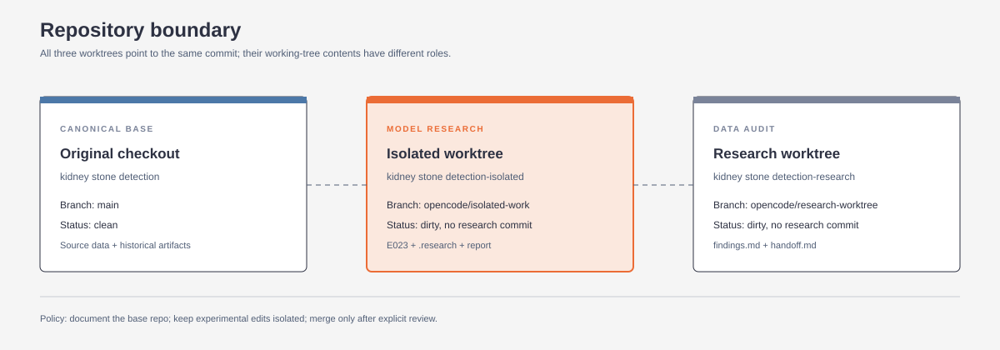
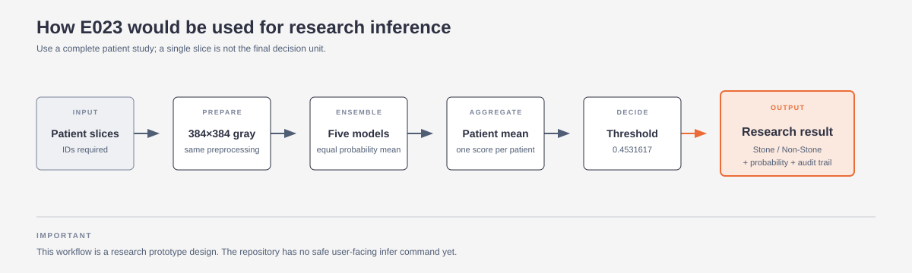

# Kidney Stone Detection Research Report

## 1. Executive summary

This project builds a two-class CT-image classifier:

- Non-Stone
- Stone

The system does not evaluate individual slices as independent medical cases. It predicts each CT slice, averages the slice probabilities for a patient, and evaluates the patient-level result. That patient-level score is the primary metric.

The final verified development candidate is E023:

- Patient-level OOF ROC-AUC: 0.853414
- Baseline patient-level OOF ROC-AUC: 0.804140
- Absolute improvement: +0.049274
- Slice-level OOF ROC-AUC: 0.814036
- Mean fold patient AUC: 0.914461
- Worst fold patient AUC: 0.863971
- Transfer guard: passed
- Correctness suite: 47 tests passed and CLI smoke test passed
- Sealed-test data: not used by E023

The research is marked GOOD_ENOUGH because E023 is a complete, leakage-checked, transfer-safe development candidate and the final verification suite passed.

This does not mean the system is clinically validated. The sealed test was previously opened by a historical failed run and collapsed to an all-positive prediction. It is permanently excluded from future tuning. There is no trustworthy untouched external evaluation result.

The practical conclusion is:

> We have a substantially better and internally verified development model. We do not yet have evidence of clinical generalization across new hospitals or a clean external cohort.

The charts and editorial diagrams in this report are deliberately separated from the metric tables: the visuals show the story, while the appendix preserves the exact experiment records. The diagram layouts follow the linked diagram-design guidance: few nodes, explicit hierarchy, no decorative shadows, and one or two focal accents.

*Figure 1. Several rejected candidates scored higher on OOF AUC than E023. The transfer guard and reproducibility gates are why E023, rather than the numerically highest OOF score, became the verified BEST.*

## 2. What the system is trying to do

The task is:

1. Read axial CT images.
2. Predict whether each image is associated with a kidney-stone patient.
3. Combine all slice predictions belonging to one patient.
4. Return one patient-level probability and decision.

The important distinction is that the label belongs to the patient, not necessarily to every individual slice. A patient may have a stone visible in only some slices, while all of that patient's slices inherit the patient label.

### Main evaluation unit

The primary evaluation score is:

    mean Stone probability across a patient's slices
    -> patient-level ROC-AUC

Slice-level ROC-AUC is retained as a secondary diagnostic metric. It is not the main ranking metric.

## 3. Dataset structure

The source is the Mendeley V2 axial CT dataset described in the repository documentation.

### Dataset counts

| Item | Count |
|---|---:|
| Total patients | 201 |
| Original source images | 3,364 |
| Original Stone images | 1,577 |
| Original Non-Stone images | 1,787 |
| Supplied derivative images | 35,457 |
| Total manifest rows | 38,821 |
| Development patients | 161 |
| Sealed-test patients | 40 |
| Development original slices | 2,796 |
| Sealed-test original slices | 568 |

*Figure 2. The dataset has many indexed rows but only 201 independent patients. The derivative rows are not independent medical examples and were excluded from final training.*

The 35,457 derivative images are indexed in the manifest but are not used by the final research model. They are not independent patients and were found to cause memorization and validation collapse.

### Patient-wise split

The split is frozen:

- 161 patients for development
- 40 patients for the sealed test
- Five patient-wise folds inside the 161 development patients
- Fold sizes: 33, 33, 33, 31, and 31 patients

No patient is allowed to appear in both training and validation for a fold. The split hashes are identical between the baseline and E023:

- Outer split SHA-256: 966d1d8f4d0b17a09db1182e3a9a5194ab7283fe85d63738cb4023e0e4b9c931
- CV fold SHA-256: 32bf8373df2b09e4d9b53b6ba93616aff618a668c2592bc3f2a532b4379b4290
- Manifest SHA-256: b4ec07b42bd38e8dcc4b3689b50cd18080ed9b2dd7e5ade38728bfc8d24ef206

### Dataset-finding thread and quarantined alternatives

The audit did not treat every dataset that looked similar online as a valid external cohort. The current training source is the Mendeley Data V2 dataset referenced by the base README: DOI [10.17632/fwhytt5mzd.2](https://data.mendeley.com/datasets/fwhytt5mzd/2), 201 patients, and the original/derivative structure described above.

The search also found several related-looking sources. The audit conclusions were:

| Candidate | Finding | Decision |
|---|---|---|
| Figshare `30342145` | Same Iraq-lineage material; approximately 3,362 original CRC entries overlap the current source | Do not count as a new cohort |
| KAUH report | Claims roughly 8,400 images from 120 patients, but public material does not provide patient mapping, image labels, or sufficient licensing evidence | Request documentation; do not train |
| Yildirim repositories | Approximately 1,799 images, but the directory structure appears to mirror the same dataset family and provides no independent patient-level evidence | Treat as mirrors, not new data |
| KidneyStoneTR | Downloaded archive had 17,992 files, all 512×512 RGB JPEGs, with no CSV/JSON/TXT/DICOM patient map. Its advertised fold/holdout organization contains exact duplicate holdout images in other folds, and patient-level independence cannot be verified | Quarantine; do not use as a test set or combine into training |
| KidneyStoneTR-Seg | Segmentation extension derived from the same family, not demonstrated to be a new independent cohort | Quarantine with KidneyStoneTR |

The KidneyStoneTR archive had zero exact-file overlap with the 3,195 unique Mendeley original hashes, and normalized grayscale comparisons also found zero overlap. That is useful evidence that the files are not simply the same local images; it is not proof of an independent clinical cohort. Without patient-to-slice mapping, source documentation, and a clean duplicate audit, the advertised holdout cannot support a generalization claim.

This is why the project improved the current development pipeline instead of inflating the dataset with an unverifiable external source. The temporary audit files remain outside the repository; the decision and evidence are summarized in `D:/Documents/Desktop/kidney stone detection-research/findings.md` and `D:/Documents/Desktop/kidney stone detection-research/handoff.md`.

### Dataset flow

~~~mermaid
flowchart TD
    A[201-patient CT dataset] --> B[Manifest]
    B --> C{Original or derivative?}
    C -->|Original| D[3,364 original slices]
    C -->|Derivative| E[35,457 indexed derivatives]
    E --> F[Excluded from final training]
    D --> G[Patient-wise frozen outer split]
    G --> H[161 development patients]
    G --> I[40 sealed-test patients]
    H --> J[Five fixed CV folds]
    J --> K[Train originals plus mild online augmentation]
    J --> L[Validate on original slices only]
    I --> M[Sealed test permanently excluded from tuning]
~~~

*Figure 3. Editorial view of the data-to-candidate pipeline. The orange node is the current verified development candidate, not a clinical endpoint.*

## 4. Model and pipeline

### Model configuration

The canonical model is named kidney_cnn_v1:

- Input: 384 x 384 grayscale image
- Four convolutional blocks
- Filters: 64, 128, 256, 512
- Two 3 x 3 convolutions per block
- Batch normalization and ReLU after convolutions
- 2 x 2 max pooling after each block
- Global average pooling
- Dense layer with 192 units
- Dropout: 0.35
- Two-class softmax output
- Total parameters: 4,788,866

Training configuration:

- Batch size: 8
- Learning rate: 0.0001
- AdamW weight decay: 0.0001
- Label smoothing: 0.05
- Maximum epochs: 60
- Early stopping patience: 15
- Early stopping minimum delta: 0.002
- Reduce-learning-rate patience: 5
- Reduce-learning-rate factor: 0.5
- Minimum learning rate: 0.000001
- Mixed precision: automatic

Mild online augmentation is used only during training:

- Rotation: 10 degrees
- Translation: 3 percent
- Zoom: 5 percent
- Contrast: 10 percent
- Brightness: 5 percent

Validation and test images are not augmented.

### Pipeline flow

~~~mermaid
flowchart LR
    A[Image files] --> B[Manifest row]
    B --> C[Patient ID and source-image ID]
    C --> D[Patient-wise split]
    D --> E[Training dataset]
    D --> F[Validation dataset]
    E --> G[Preprocess and augment]
    F --> H[Preprocess only]
    G --> I[kidney_cnn_v1]
    H --> I
    I --> J[Stone probability per slice]
    J --> K[Mean probability per patient]
    K --> L[OOF ROC-AUC]
    K --> M[Youden threshold]
    M --> N[Development transfer guard]
    N --> O[Keep or reject candidate]
~~~

*Figure 4. The report uses a simplified editorial version of the pipeline so the reader can see the evaluation boundary without following every implementation detail.*

### Experiment ratchet

Every experiment followed this pattern:

~~~mermaid
flowchart TD
    A[Read current BEST] --> B[Choose one hypothesis]
    B --> C[Make the smallest useful change]
    C --> D[Run correctness checks]
    D --> E[Train or evaluate]
    E --> F[Extract primary and secondary metrics]
    F --> G{Does it beat BEST and pass hard gates?}
    G -->|Yes| H[Verify and promote]
    G -->|No| I[Record failure and discard]
    H --> J[Update research state]
    I --> J
    J --> A
~~~

*Figure 5. The autonomous research loop: every candidate was measured, checked against hard gates, and either promoted or recorded as a failure.*

## 5. Baseline: why E000 was selected

E000 was the first strong, complete, development-only reference after correcting the data-loader shuffle problem.

The baseline was selected because:

1. It completed all five patient-wise folds.
2. OOF integrity passed.
3. No fold met the collapse criterion.
4. It used the frozen splits.
5. It used original images only.
6. It did not use the sealed test.
7. It was the strongest verified result available at the start of autonomous research.

E000 was not perfect. Its development transfer guard failed, but it was still the correct reference because later candidates had to beat a known complete result under the same metric and split protocol.

### E000 baseline metrics

| Metric | Value |
|---|---:|
| Patient OOF ROC-AUC | 0.804140 |
| Slice OOF ROC-AUC | 0.796691 |
| Mean fold patient AUC | 0.812745 |
| Worst fold patient AUC | 0.661765 |
| Fold patient AUCs | 0.867647, 0.930147, 0.661765, 0.741667, 0.862500 |
| Best epochs | 30, 31, 1, 1, 8 |
| Locked threshold | 0.430775 |
| Transfer KS | 0.397516 |
| Transfer threshold-rate delta | 0.236025 |
| Transfer result | FAIL |

The baseline was therefore a research champion, not a deployable candidate.

## 6. Complete experiment history

The append-only experiment log contains 27 numbered records: E000 through E026. Not every record is a new model training run. Some are infrastructure fixes, transfer audits, prediction ensembles, or robustness analyses.

### Historical experiments before the numbered autonomous loop

| Stage | What happened | Main result |
|---|---|---|
| Derivative-enabled training | Trained with supplied derivatives | Memorization and validation collapse; validation loss rose above 7 |
| Fold-0 probe | Original images with stronger regularization | Patient AUC 0.5588 |
| Over-regularized CV | Full five-fold trial | Patient AUC 0.4669; rejected |
| Fold-3 middle-ground probe | Lower learning rate and moderate regularization | Patient AUC 0.6250; single-fold signal only |
| Pre-shuffle complete CV | Original loader with partial shuffle | Patient OOF AUC 0.544640; fold collapse |
| Historical complete CV plus final test | OOF looked acceptable, then final model collapsed | Sealed test AUC 0.538462; all patients predicted Stone |

### Numbered experiments E000-E026

| ID | Experiment | Result and lesson |
|---|---|---|
| E000 | Full-dataset shuffle baseline | Patient OOF AUC 0.804140; new research reference |
| E001 | Backend-neutral smoke-test repair | Infrastructure only; no metric change |
| E002 | Seed-43 fold-2 diagnostic | Patient AUC 0.680147; slight same-fold improvement, not global evidence |
| E003 | Seed-43 fold-3 diagnostic | Patient AUC 0.866667; strong fold signal, but seed variance remained possible |
| E004 | Complete seed-43 CV | Patient OOF AUC 0.854032; strong OOF candidate |
| E005 | E004 15-epoch final retrain transfer | Failed: std 0.103676, KS 0.726708, threshold delta 0.503106 |
| E006 | E004 epoch-1 final retrain | Failed: std 0.047622, KS 0.447205, delta 0.447205 |
| E007 | Three-pass BatchNorm recalibration | Spread fixed, but KS 0.322981; rejected |
| E008 | One-pass BatchNorm recalibration | KS 0.316770; calibration pass count was not the solution |
| E009 | Equal mean of E004 fold checkpoints | Near miss: KS 0.173913 |
| E010 | Median of E004 fold checkpoints | Worse: KS 0.242236 |
| E011 | Patient-balanced fold-2 training | Patient AUC 0.683824, slice AUC fell; not material |
| E012 | Independent subset-ensemble audit | Seed-43 subset near-pass did not reproduce |
| E013 | Seed-44 CV | Interrupted by external Windows logoff; incomplete |
| E014 | Recovered seed-44 CV | Patient OOF AUC 0.804603; no meaningful improvement |
| E015 | Cross-seed E004/E014 ensemble | Patient OOF AUC 0.871486, but KS 0.180124 |
| E016 | Convex E004/E014 blend grid | No blend passed KS < 0.15 |
| E017 | Patient-AUC checkpoint selector, seed-44 fold 0 | Patient AUC 0.816176 vs 0.555147 canonical |
| E018 | Patient-AUC selector, seed-44 fold 4 | Patient AUC 0.854167 vs 0.666667 canonical |
| E019 | Complete seed-44 patient-AUC selector CV | Patient OOF AUC 0.834415; transfer still pending |
| E020 | E019 five-checkpoint ensemble transfer | KS 0.167702; near miss |
| E021 | E019 exact-26-epoch single retrain | KS 0.378882; single-model final protocol failed |
| E022 | Independent seed-43 fold-2 selector replication | Patient AUC 0.863971 vs 0.680147 |
| E023 | Complete seed-43 patient-AUC selector CV | Patient OOF AUC 0.853414; all transfer gates passed; promoted |
| E024 | Equal E019/E023 cross-seed blend | OOF AUC 0.856194, but KS 0.192547 |
| E025 | Predeclared 21-point cross-seed weight grid | No transfer-safe gain over E023 |
| E026 | Site and patient-slice-count robustness audit | Overall gain retained; small-site uncertainty recorded |

### How many runs were conducted?

The persistent ledger contains **27 numbered records: E000 through E026**. They are not 27 identical full training runs:

| Category | Count | Meaning |
|---|---:|---|
| Training, retraining, or checkpoint-selection studies | 17 | Complete CVs, single-fold diagnostics, final-retrain probes, and BatchNorm recalibration |
| Ensemble, transfer, blend, or robustness audits | 9 | Existing checkpoints were re-evaluated without retraining, or fixed predictions were compared |
| Infrastructure/correctness repair | 1 | Backend-neutral smoke-test repair; no model metric changed |
| **Total tracked records** | **27** | Every result, failure, and interruption is retained |

The historical pre-loop work adds earlier derivative, regularization, shuffle, and sealed-test investigations. Those are described in the preceding table but are not silently counted as additional E000–E026 records.

The full exact ledger is preserved in [the experiment metrics appendix](report_assets/experiment_metrics_appendix.md) and the machine-readable source file at `D:/Documents/Desktop/kidney stone detection-isolated/.research/results.jsonl`. It includes every `metric`, `secondary`, status, hypothesis, reason, seed, fold, and run directory.

### What changed the frontier

The two most important interventions were:

1. Fixing the training shuffle.
2. Selecting checkpoints using patient-level validation ROC-AUC instead of only slice-level validation loss.

The first fixed a real training-order problem. The second aligned model selection with the actual primary evaluation unit.

## 7. Critical findings

### Finding 1: The old shuffle was genuinely harmful

The original manifest was class-ordered. A shuffle buffer of 1,024 was too small for the 2,796-image development set. A label-only reproduction showed:

- No positive examples in the first 72 batches.
- The final 50 batches were approximately 71.5 percent positive.

This created class-blocked training epochs. Full-dataset shuffling corrected the mechanism and improved patient OOF AUC from the pre-shuffle 0.544640 to E000's 0.804140.

### Finding 2: Supplied derivatives are not safe extra data

The dataset contains 35,457 supplied derivative images, but they are correlated transformations, not new patients. Training with them produced:

- Very high training accuracy.
- Very poor validation behavior.
- Very high validation loss.
- Evidence of memorization and distribution mismatch.

The final configuration therefore uses original slices only and keeps derivatives disabled.

### Finding 3: Patient-level labels make slice-level loss noisy

Every slice inherits its patient's label. A positive patient may have many slices without a visually obvious stone. The visual audit estimated that approximately 25-45 percent of Stone-labeled slices may not visibly contain a stone. This is an approximate audit estimate, not a verified annotation percentage.

This explains why:

- Slice validation loss is noisy.
- Slice-level AUC and patient-level AUC can disagree.
- Patient-level checkpoint selection is more aligned with the real task.

### Finding 4: The final single-model retrain is not equivalent to CV

The CV model is actually five different fold models, each selected from held-out patients. A final retrain is one new model trained on all development patients. It has no held-out fold and can produce a different score distribution.

E005, E006, and E021 showed that a single full-development retrain can:

- Predict almost everyone positive.
- Predict almost everyone negative.
- Have good in-sample metrics but fail transfer.

Therefore E023 uses the validated five-checkpoint ensemble rather than the old naive final retrain.

### Finding 5: Site and file format are confounded with labels

Development site composition:

- FA: 42 patients
- ME: 20 patients
- RA: 99 patients

The test split has a different composition:

- FA: 23 patients
- ME: 9 patients
- RA: 8 patients

RA is also associated with a different image format pattern. A site-only baseline achieved approximately 0.562 AUC, close to the original weak model. This means a model can obtain signal from acquisition/site shortcuts rather than stone appearance.

### Finding 6: E023 is better, but not uniformly better

E023 improves overall performance, FA performance, RA performance, and most slice-count groups. It is lower on ME, which contains only 20 patients, and lower for patients with 31+ slices. That is uncertainty, not evidence that the model is universally robust.

### Finding 7: The transfer guard is necessary but not a clinical validation

The transfer guard compares:

- OOF scores from models evaluated on patients they did not train on.
- Development scores from the ensemble evaluated on the full development population.

It is useful for detecting score collapse and distribution mismatch. It is not an independent external test. E023 passing it means the candidate is internally coherent, not that it will necessarily generalize to a new hospital.

*Figure 6. E023's five patient-level fold AUCs are all strong; earlier candidates contained near-chance folds even when their pooled OOF AUC looked attractive.*

*Figure 7. The strict transfer gates reject several attractive-looking candidates. E023 is the highlighted candidate that passes KS, score-spread, and threshold-prevalence checks together.*

## 8. E023 complete metric report

### Patient-level primary metrics

| Metric | Value |
|---|---:|
| Patients | 161 |
| Positive patients | 78 |
| Negative patients | 83 |
| OOF slices | 2,796 |
| ROC-AUC | 0.853414 |
| PR-AUC | 0.860588 |
| Youden threshold | 0.453162 |
| Youden J | 0.609515 |
| Sensitivity | 0.717949 |
| Specificity | 0.891566 |
| Precision | 0.861538 |
| F1 | 0.783217 |
| Balanced accuracy | 0.804757 |
| TN | 74 |
| FP | 9 |
| FN | 22 |
| TP | 56 |

At this threshold, the model misses 22 of 78 positive patients and incorrectly flags 9 of 83 negative patients. The operating threshold can be changed for a different clinical cost tradeoff, but that would require a predeclared decision policy.

### Patient-level metrics at threshold 0.5

| Metric | Value |
|---|---:|
| Sensitivity | 0.666667 |
| Specificity | 0.903614 |
| Precision | 0.866667 |
| F1 | 0.753623 |
| Balanced accuracy | 0.785141 |
| TN, FP, FN, TP | 75, 8, 26, 52 |

### Slice-level secondary metrics

| Metric | Value |
|---|---:|
| ROC-AUC | 0.814036 |
| PR-AUC | 0.802870 |
| Sensitivity | 0.634365 |
| Specificity | 0.840561 |
| Precision | 0.757046 |
| F1 | 0.690297 |
| Balanced accuracy | 0.737463 |
| TN, FP, FN, TP | 1,318, 250, 449, 779 |

### Fold metrics

| Fold | Patients | Best epoch | Patient AUC | Probability std |
|---:|---:|---:|---:|---:|
| 0 | 33 | 23 | 0.937500 | 0.240461 |
| 1 | 33 | 16 | 0.937500 | 0.331678 |
| 2 | 33 | 26 | 0.863971 | 0.321003 |
| 3 | 31 | 25 | 0.912500 | 0.320205 |
| 4 | 31 | 29 | 0.920833 | 0.320377 |

### Transfer guard

| Check | Value | Gate | Result |
|---|---:|---:|---|
| Development probability std | 0.373026 | >= 0.10 | PASS |
| KS versus OOF | 0.130435 | < 0.15 | PASS |
| OOF positive rate | 40.3727% | reference | n/a |
| Development positive rate | 46.5839% | reference | n/a |
| Positive-rate delta | 0.062112 | <= 0.10 | PASS |

### Per-site patient AUC

| Site | Patients | Baseline | E023 |
|---|---:|---:|---:|
| FA | 42 | 0.733333 | 0.782716 |
| ME | 20 | 0.885417 | 0.812500 |
| RA | 99 | 0.788843 | 0.869008 |

*Figure 8. E023 improves FA and RA, while ME is lower on only 20 patients. That small-site result is recorded as uncertainty rather than hidden or tuned away.*

### Patient slice-count subgroup AUC

| Original slices per patient | Patients | Baseline | E023 |
|---|---:|---:|---:|
| 1-10 | 69 | 0.728956 | 0.791246 |
| 11-20 | 38 | 0.850416 | 0.925208 |
| 21-30 | 30 | 0.814480 | 0.927602 |
| 31+ | 24 | 0.900000 | 0.828571 |

The full site and subgroup threshold metrics are preserved in:

    runs/20260911_e026_e023_robustness_audit/robustness_audit.json

One exact-threshold patient is serialized at the threshold boundary. The canonical E023 in-memory evaluator uses the locked threshold with >= and reports TP=56/FN=22. A later CSV subgroup audit used a rounded decimal representation and differed by one boundary patient. ROC-AUC is unaffected. The canonical E023 oof_metrics.json is the authoritative metric artifact.

## 9. What 'good model' means here

### What is good

E023 is good relative to the defined development task because:

- It beats the baseline by a meaningful margin.
- The gain survives five patient-wise folds.
- The worst fold is much stronger than baseline.
- OOF integrity passes.
- The development transfer guard passes.
- The independent seed-44 selector study provided supporting evidence.
- The final correctness suite passes.
- Frozen manifest and split hashes match the baseline.
- No sealed-test data was used by E023.

### What is not proven

E023 does not prove:

- Clinical usefulness.
- Generalization to a new hospital.
- Generalization to a new scanner or acquisition protocol.
- Reliable performance on a new prevalence distribution.
- A clinically acceptable false-negative rate.
- Performance on the permanently invalidated sealed test.

The honest description is:

> E023 is a strong internal development candidate and a reasonable basis for an inference prototype, not a clinically validated diagnostic model.

## 10. Repository and script status

*Figure 9. The clean base checkout is the reference point. The isolated worktree contains the E023 research state; the research worktree contains the dataset-finding thread and handoff documentation.*

### Three worktrees and version-control boundary

All three worktrees point to commit `68b0c8dc09591f21b663c71d2a2a9d1a9922a845` (`68b0c8d`). The working-tree contents are intentionally different:

| Location | Branch | Status | Role |
|---|---|---|---|
| `D:/Documents/Desktop/kidney stone detection` | `main` | Clean | Canonical base repo, source images, historical artifacts |
| `D:/Documents/Desktop/kidney stone detection-isolated` | `opencode/isolated-work` | Dirty; no research commit | E023 code, runs, `.research/`, report, and model artifacts |
| `D:/Documents/Desktop/kidney stone detection-research` | `opencode/research-worktree` | Dirty; no research commit | `findings.md`, `handoff.md`, dataset audit, and planning context |

The local safety stash is `stash@{0}` (`On main: opencode: preserve local work before moving to research worktree`). The separate local branch `feat/dataset-preparation-and-frozen-splits` is at `6ccfb40`; it is not the E023 champion state. No autonomous research commit was created.

### Original checkout

The original checkout is clean:

    D:/Documents/Desktop/kidney stone detection

It was protected from autonomous research changes.

### Isolated worktree

The isolated worktree contains the working pipeline used for E023:

    D:/Documents/Desktop/kidney stone detection-isolated

Its source changes include data loading, preprocessing, model definition, split validation, training, evaluation, tests, and CLI behavior. It also contains research scripts and persistent state under .research.

No commit was created for the isolated research changes. The E023 artifacts, configuration, hashes, logs, and metric files are the reproducibility record.

### What exists in the base repository?

The clean base repo contains the original end-to-end CNN project:

| Base-repo path | Responsibility |
|---|---|
| `D:/Documents/Desktop/kidney stone detection/README.md` | Dataset reference, installation, CLI quick start, run-artifact layout, and test instructions |
| `D:/Documents/Desktop/kidney stone detection/train.py` | Orchestrates `prepare`, `smoke`, `cv`, and `finalize`; it has no safe `infer` subcommand |
| `D:/Documents/Desktop/kidney stone detection/configs/default.yaml` | Original model, data, augmentation, optimizer, and evaluation defaults |
| `D:/Documents/Desktop/kidney stone detection/src/data.py` | Filename metadata parsing, manifest creation, image preprocessing, augmentation, and dataset construction |
| `D:/Documents/Desktop/kidney stone detection/src/model.py` | `kidney_cnn_v1` convolutional network definition |
| `D:/Documents/Desktop/kidney stone detection/src/splits.py` | Patient-wise outer split, five CV folds, duplicate/source grouping, leakage checks, and split hashes |
| `D:/Documents/Desktop/kidney stone detection/src/trainer.py` | Model compilation, fold training, callbacks, checkpointing, and full-development retraining |
| `D:/Documents/Desktop/kidney stone detection/src/evaluate.py` | Threshold metrics, ROC/PR/confusion plots, OOF aggregation, sealed-test evaluation, and bundle export |
| `D:/Documents/Desktop/kidney stone detection/src/utils.py` | Configuration, seeds, hashes, metadata, runtime/GPU information, and mixed-precision setup |
| `D:/Documents/Desktop/kidney stone detection/tests/` | Tests for data, evaluation, smoke behavior, splits, training, and utilities |
| `D:/Documents/Desktop/kidney stone detection/requirements.txt` | Base TensorFlow/Keras, data-science, plotting, and test dependencies |
| `D:/Documents/Desktop/kidney stone detection/splits/` | Frozen outer and CV split CSVs |

The base CLI was designed for a conventional sequence: prepare data, smoke-test the code, run five-fold CV, and optionally finalize. The research process deliberately stopped short of the original `finalize` path because that command retrains a single model and opens the sealed test.

### Base repo versus isolated research changes

The isolated worktree differs from the base snapshot in **14 tracked files**, with approximately **1,695 insertions and 169 deletions**, plus untracked research state and documentation. The changes were research instrumentation and evaluation hardening, not a silent rewrite of the base repo:

| Area | Base repo behavior | Isolated research behavior used for E023 |
|---|---|---|
| Data order | Partial shuffle could preserve class blocks | Full filtered-dataset shuffle; derivatives disabled |
| Manifest integrity | Metadata-oriented manifest | File existence, byte-hash, dimensions, channel, and path-boundary validation |
| Evaluation unit | Original code centered on slice metrics | Patient mean-probability aggregation is primary; slice metrics remain secondary |
| Checkpoint selection | Slice validation loss was the main selector | Patient-level validation ROC-AUC selector was tested and used for E023 |
| OOF integrity | Basic fold aggregation | Exact coverage, duplicate, fold, patient, source-ID, and manifest alignment checks |
| Transfer safety | No development transfer gate | Score spread, KS-vs-OOF, and threshold prevalence guard before promotion |
| Model runtime | Standard BatchNorm path | Custom fp16-safe BatchNorm plus numerical-equivalence regression coverage |
| CLI/tests | Original smoke/test assumptions | Backend-neutral conversion helpers, seed/patient-balanced options, and 47-test verification |

The source images remain in `D:/Documents/Desktop/kidney stone detection/data/`. The isolated worktree contains the frozen manifest and run artifacts but does not contain the source-image tree; E023 inference and transfer audits resolved images against the frozen source tree explicitly.

### Important commands

The canonical CLI contains:

    python train.py prepare
    python train.py smoke
    python train.py cv
    python train.py finalize

The smoke command and tests pass. The finalize command must not be used for this research result because its design retrains a single model and opens the sealed test. A safe inference command has not yet been added.

## 11. Inference design

E023 inference should work like this:

~~~mermaid
flowchart TD
    A[Input slices grouped by patient] --> B[Load five E023 best.keras files]
    B --> C[Apply identical grayscale preprocessing]
    C --> D[Predict Stone probability with each model]
    D --> E[Average five fold probabilities per slice]
    E --> F[Average slice probabilities per patient]
    F --> G{Probability >= 0.4531617?}
    G -->|Yes| H[Stone]
    G -->|No| I[Non-Stone]
~~~

*Figure 10. The intended inference path uses all five E023 fold checkpoints and aggregates at the patient level. This is a research workflow, not a medical deployment interface.*

The five checkpoints are:

    D:/Documents/Desktop/kidney stone detection-isolated/runs/20260911_e023_seed43_patient_auc_cv/fold_0/best.keras
    D:/Documents/Desktop/kidney stone detection-isolated/runs/20260911_e023_seed43_patient_auc_cv/fold_1/best.keras
    D:/Documents/Desktop/kidney stone detection-isolated/runs/20260911_e023_seed43_patient_auc_cv/fold_2/best.keras
    D:/Documents/Desktop/kidney stone detection-isolated/runs/20260911_e023_seed43_patient_auc_cv/fold_3/best.keras
    D:/Documents/Desktop/kidney stone detection-isolated/runs/20260911_e023_seed43_patient_auc_cv/fold_4/best.keras

For a single slice, the output is a slice probability. For a patient, the correct output is the mean probability across all supplied slices. A patient-level result should not be interpreted from one arbitrary slice when the full patient study is available.

The next engineering step is to create a separate inference wrapper that:

1. Loads the five checkpoints.
2. Verifies input decoding and image shape.
3. Requires a patient ID for each slice.
4. Writes slice probabilities.
5. Writes patient-level probabilities and decisions.
6. Records the model path, threshold, preprocessing configuration, and timestamp.

This wrapper should not call finalize and should not touch the sealed-test partition.

## 12. Main bottlenecks

The main bottleneck is data quality and generalization, not simply model capacity.

### Bottleneck A: weak labels

Patient-level labels are copied to slices. The model is asked to learn from many slices that may not visibly show a stone. This creates label noise and makes slice-level validation loss an imperfect checkpoint criterion.

### Bottleneck B: small effective sample size

There are 201 patients total, only 161 in development, and only 31-33 patients per fold. Thousands of slices do not equal thousands of independent medical cases.

### Bottleneck C: acquisition/site shift

Site and file format are correlated with split membership and labels. A model can learn scanner or site appearance instead of stone evidence.

### Bottleneck D: split conflicts and duplicates

There are 154 cross-patient byte-identical original slices and several conflicting-label duplicate components. The frozen split keeps known components together, but fresh split generation requires an explicit data-policy decision.

### Bottleneck E: final-training score drift

The old single-model final retrain did not preserve the OOF score regime. This is why E023 uses an ensemble of held-out-fold checkpoints rather than assuming that one all-development retrain is equivalent.

### Bottleneck F: no clean external test

The historical sealed test was opened and produced an all-positive collapse. It cannot be reused for tuning. A new independent, untouched external cohort is required for a genuine generalization claim.

## 13. How to improve the project next

Research is complete at the current defined bar. If research is deliberately resumed, the highest-value directions are:

1. Build and test the E023 inference wrapper on a small, explicitly documented development-only sample.
2. Obtain a new untouched patient-level validation cohort from different sites.
3. Improve labels with slice-level or region-level stone annotations.
4. Revisit the frozen split policy after explicitly resolving duplicate/conflicting-label components.
5. Use site-stratified patient-wise development analysis without using any future test labels.
6. Investigate domain generalization and acquisition normalization only with a new independent holdout.
7. Consider patient-aware learning objectives or multiple-instance learning so that not every slice must be treated as equally positive.
8. Add calibration and uncertainty reporting after ranking performance is verified on a clean external cohort.
9. Define an abstain/review category for uncertain patients rather than forcing every patient into Stone or Non-Stone.
10. Only then consider a new production training protocol.

### Recommended future roadmap

The next improvement should be **better evidence**, not a more complicated CNN:

1. Build a separate research-only inference wrapper around the five E023 checkpoints.
2. Obtain an untouched, patient-mapped cohort from a different acquisition site.
3. Resolve duplicate and conflicting-label components before generating any new split.
4. Add slice-level or region-level annotations so the loss does not assume every slice is visibly positive.
5. Re-run the same patient-level OOF and transfer protocol on the new cohort.
6. Only after external robustness is demonstrated, study calibration, abstention, domain generalization, or a different architecture.

The current evidence says the bottleneck is the number and quality of independent patients, weak slice labels, and site/format confounding. Architecture search before addressing those issues would mostly make it easier to fit the same limitations.

## 14. Final conclusion

The project began with a model whose apparently reasonable results were undermined by class-ordered batching, correlated derivatives, weak slice labels, site confounding, and a final-retrain distribution collapse.

The research process corrected the most important training-order problem, excluded unsafe derivatives, froze patient-wise evaluation, aligned checkpoint selection with the patient-level objective, tested independent seeds, rejected transfer failures, and verified a five-checkpoint ensemble.

E023 is the first candidate that simultaneously:

- materially improves the baseline,
- passes complete five-fold OOF evaluation,
- passes the development transfer guard,
- survives robustness review,
- passes the correctness suite,
- preserves the frozen split and manifest provenance,
- and avoids the sealed-test boundary.

It is therefore the correct model to use for an inference prototype. It is not yet evidence of clinical deployment readiness.

## 15. Key artifacts

- Research contract: .research/config.json
- Current BEST: .research/best.json
- Full experiment history: .research/results.jsonl
- Compact state: .research/state.md
- E023 OOF metrics: runs/20260911_e023_seed43_patient_auc_cv/oof_metrics.json
- E023 threshold: runs/20260911_e023_seed43_patient_auc_cv/threshold.json
- E023 transfer guard: runs/20260911_e023_seed43_patient_auc_cv/final_ensemble_transfer/development_transfer.json
- E026 robustness audit: runs/20260911_e026_e023_robustness_audit/robustness_audit.json
- Dataset and process handoff: handoff.md
- Build contract: spec_text.txt
- Canonical CLI: train.py
- Full exact metric appendix: report_assets/experiment_metrics_appendix.md
- Report charts and editorial diagrams: report_assets/
- Clean base repository: D:/Documents/Desktop/kidney stone detection
- Dataset-finding report: D:/Documents/Desktop/kidney stone detection-research/findings.md

## 16. References and design notes

1. Abdalla et al., *Kidney stone detection via axial CT imaging: A dataset for AI and deep learning applications*, Mendeley Data V2, DOI [10.17632/fwhytt5mzd.2](https://data.mendeley.com/datasets/fwhytt5mzd/2). The local repository cites this source in `D:/Documents/Desktop/kidney stone detection/README.md`.
2. [Diagram Design by cathrynlavery](https://github.com/cathrynlavery/diagram-design). Used as visual guidance for the PDF diagrams: editorial hierarchy, low node density, clear focal accents, static accessible SVG, and no decorative shadows. The diagrams in `report_assets/` are project-specific redraws; the research code and base repo do not depend on that external repository.
3. The exact local research contract and results remain the primary evidence: `D:/Documents/Desktop/kidney stone detection-isolated/.research/config.json`, `best.json`, `state.md`, and `results.jsonl`.
